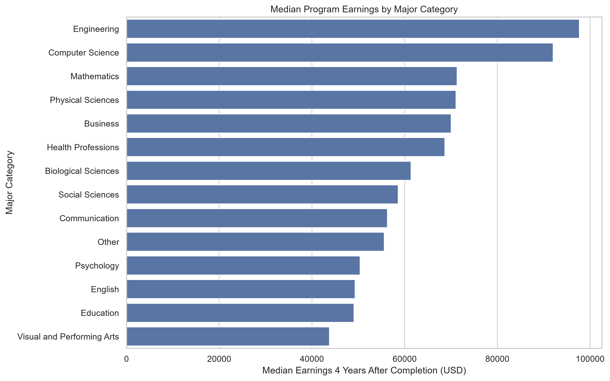
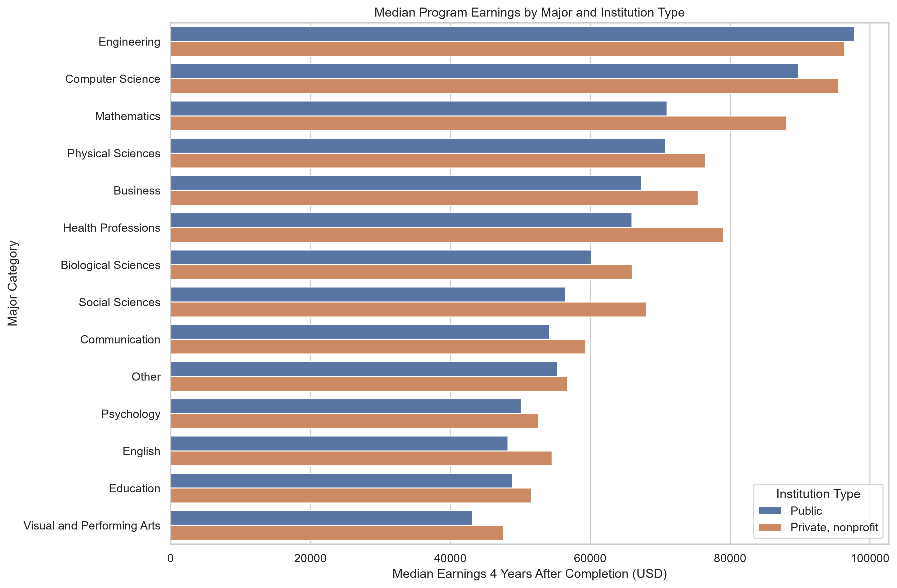

## Introduction

Does your college major affect how much money you earn after graduation? This is an important question for students deciding what to study. Although personal interests and career goals matter, understanding potential earnings can help students make more informed decisions.

For this project, I used the U.S. Department of Education's College Scorecard API to investigate two questions:

1. How do median earnings differ across college majors?
2. How do these differences vary between public and private nonprofit universities?

My goal was not only to explore these questions but also to practice acquiring real-world data through an API, cleaning it, and creating an original dataset for analysis.

## Getting Data from the College Scorecard API

The [College Scorecard](https://collegescorecard.ed.gov/data/) provides information about U.S. colleges, including institutional characteristics, academic programs, and graduate earnings.

I accessed the data using Python's `requests` library. Instead of downloading a ready-made dataset, I sent API requests and extracted information from nested JSON responses.

For example, the API returns program-level information inside each institution's record. I used Python loops to extract university names, academic majors, degree levels, institutional types, and median earnings four years after completion.

The acquisition script requested 20 pages of data, with up to 20 institutions per page. After extracting bachelor's degree programs, I obtained **5,507 program observations from 175 universities**.

This process demonstrated how an API can provide structured information while still requiring substantial data transformation.

## Cleaning and Transforming the Data

The raw dataset needed additional processing before analysis.

First, I restricted the sample to public and private nonprofit universities. I excluded for-profit institutions to focus on the two institutional categories in my research question.

Second, I retained programs with available institution-specific median earnings four years after completion. Many programs had missing earnings values, potentially because of reporting limitations or data suppression.

Third, I used the Classification of Instructional Programs (CIP) codes to group individual majors into broader categories such as Engineering, Computer Science, Business, and Psychology.

Finally, I created two additional variables: the difference between institutional and national median earnings and the ratio of institutional to national earnings.

The resulting dataset contained **2,369 observations, 122 universities, and 13 variables**.

This transformation created a dataset specifically designed to answer my research questions.

## Finding 1: Earnings Differ Substantially Across Majors

Engineering had the highest median program earnings at **$97,656**, followed by Computer Science at **$92,014**.

Mathematics ($71,317), Physical Sciences ($71,084), and Business ($70,025) also ranked relatively high.

In contrast, Visual and Performing Arts had the lowest median among the categories analyzed, at **$43,758**. Education ($49,080) and English ($49,297.50) also had comparatively lower values.

The difference between Engineering and Visual and Performing Arts was approximately **$53,898**.

These results suggest that academic field is strongly associated with differences in reported program earnings in this sample.

However, the analysis compares program-level median earnings, not individual graduates. It does not establish that choosing a particular major causes higher earnings.

## Finding 2: Private Nonprofit Programs Generally Report Higher Earnings

Across all programs, the median was **$62,886** for private nonprofit universities and **$59,041.50** for public universities.

This represents a difference of approximately **$3,845**, or 6.5% relative to the public university median.

However, the overall difference may reflect variations in the types of majors offered, university characteristics, or geographic location.

To investigate this further, I compared public and private nonprofit universities within each major category.

In 13 of the 14 categories, private nonprofit programs had higher median earnings. However, the private nonprofit groups for Mathematics and Physical Sciences each contained only one observation, making those comparisons especially unreliable.

## Finding 3: Engineering Is an Interesting Exception

Engineering showed a different pattern.

Public university Engineering programs had median earnings of **$97,790**, compared with **$96,418.50** for private nonprofit programs.

The difference was approximately **$1,372** in favor of public universities.

Meanwhile, Health Professions showed a much larger difference in the opposite direction: $79,062 for private nonprofit programs versus $65,961 for public programs.

These findings demonstrate why comparing institutions within academic fields can reveal patterns that are hidden in overall averages.

## Limitations and Ethical Considerations

This analysis has several important limitations.

First, I collected data from the first 20 API result pages rather than selecting a nationally representative random sample. Therefore, these findings should not be generalized to every U.S. university.

Second, a substantial number of programs lacked institution-specific earnings data. Excluding these programs may introduce selection bias, particularly if missingness is related to program size or other characteristics.

Third, the analysis treats every program equally, regardless of its number of graduates. Consequently, the reported summaries are not estimates of the median earnings of all graduates.

Finally, these comparisons do not control for factors such as student background, university selectivity, geographic location, or prior academic achievement.

From an ethical perspective, I used publicly available aggregate data rather than individual student records. I also kept the API key outside the repository and documented the limitations to avoid misleading interpretations.

## Conclusion

This project showed me how to transform API responses into a dataset suitable for statistical exploration.

Engineering and Computer Science had the highest median program earnings in the sample, while private nonprofit universities generally showed higher earnings than public universities. However, Engineering provided an important exception.

The most valuable lesson was that collecting data is only the beginning. Understanding missing values, selecting appropriate comparisons, and communicating limitations are essential parts of responsible data science.

Future research could use a broader sample of universities and statistical models that account for institutional and geographic differences.

## Resources

- [College Scorecard Data](https://collegescorecard.ed.gov/data/)
- [College Scorecard API](https://collegescorecard.ed.gov/data/api/)
- [Project GitHub Repository](https://github.com/takato-byu/data_acquisition_blog)